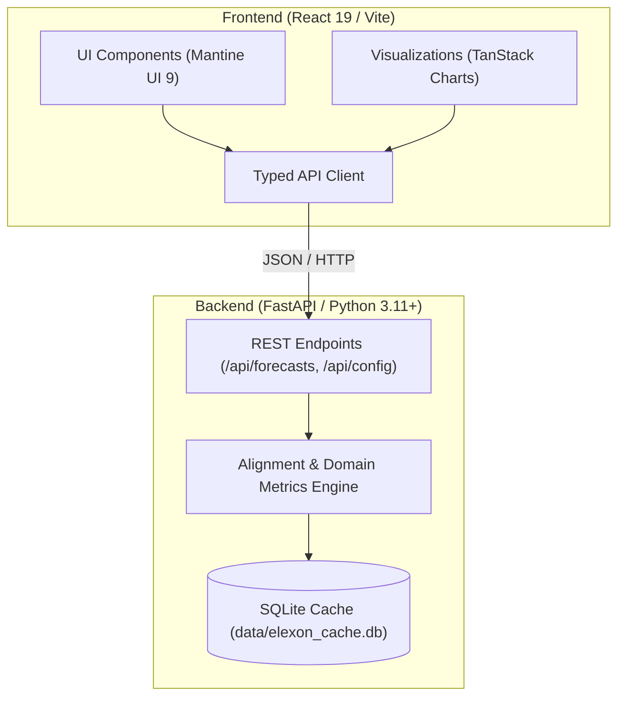

# UK Wind Power Day-Ahead Forecasting & Procurement Portal

A web application developed for a UK energy utility trading desk to analyze national wind power forecasts and quantify thermal backup requirements in wholesale Day-Ahead electricity markets. The application aligns forecast snapshots against market auction gate closures to eliminate lookahead bias and calculates accuracy metrics across January 2026 data from Elexon BMRS.

---

## Deliverables & Links

- **Live Application (Vercel):** [wasdef.vercel.app](https://wasdef.vercel.app/)
- **Demo Video (YouTube):** [Link to Unlisted YouTube Video](https://youtube.com)

---

## Problem & Context

UK energy utilities must procure electricity on the wholesale market to meet consumer demand. Day-ahead purchase decisions are made on day $D-1$, requiring traders to commit to physical power volumes before delivery day $D$. 

Because wind generation is weather-dependent and volatile, procurement desks must:
1. **Access the latest wind generation forecast available at auction gate closure:** Using forecasts published after gate closure introduces lookahead bias into historical analysis.
2. **Quantify forecast error:** When wind generation falls short of forecast, utilities must procure replacement dispatchable power (such as CCGT thermal generation) or face system imbalance cashout penalties. Evaluating forecast error quantitatively allows desks to size thermal reserves and hedge price risk.

### Market Gate Closures

The portal models standard UK Day-Ahead wholesale market gate closures:
- **EPEX SPOT UK Day-Ahead 60m Auction:** Gate closure at **09:20 GMT** on $D-1$.
- **Nord Pool N2EX Day-Ahead Auction:** Gate closure at **09:50 GMT** on $D-1$.
- **EPEX SPOT UK Day-Ahead 30m Auction:** Gate closure at **14:30 GMT** on $D-1$.
- **Custom Cutoff:** An interactive slider allows desks to test any decision cutoff from 06:00 to 22:00 on $D-1$.

---

## Data Scope & Ingestion

Per challenge specifications, data is sourced exclusively from national Elexon BMRS datasets for **January 2026**:

1. **Actual Wind Generation (`FUELHH`):**
   - Half-hourly outturn generation (30-minute settlement periods).
   - Filtered for `fuelType == "WIND"`.
2. **Forecasted Wind Generation (`WINDFOR`):**
   - National wind generation forecasts published at regular intervals.
   - Key attributes: `startTime` (target period), `publishTime` (timestamp when forecast was issued), and `generation` (forecasted MW).

### Alignment Logic
For each half-hour settlement period on delivery day $D$, the backend queries the `WINDFOR` dataset for the latest forecast where `publishTime <= cutoff_timestamp(D-1)`. This ensures the forecast evaluated reflects exactly what a trader had on their screen when placing bids.

A pre-ingested SQLite database (`data/elexon_cache.db`, ~3.2 MB) is bundled with the repository, allowing full offline operation without runtime external API dependencies.

---

## Architecture & Technology Stack

The project uses a decoupled client-server architecture:



- **Frontend:**
  - **React 19** with **TypeScript** and **Vite** for fast client-side rendering.
  - **Mantine UI 9:** Layout, date range picker, auction preset segmented controls, and cutoff slider.
  - **TanStack Charts:** Time-series actual vs. forecast chart, imbalance delta bars, and diurnal error profiles.
- **Backend:**
  - **Python 3.11+** with **FastAPI** and **Uvicorn**.
  - **Pydantic v2** for request/response validation.
  - **SQLite** storage engine for cached Elexon records.
- **Deployment & Containerization:**
  - **Docker & Docker Compose** for containerized local execution.
  - **Vercel** serverless Python integration via `vercel.json` and `api/index.py`.

---

## Directory Structure

```
.
├── backend/
│   ├── app/
│   │   ├── api/
│   │   │   ├── config.py         # Gate closure presets and date range configurations
│   │   │   ├── dependencies.py   # Database session dependency injection
│   │   │   └── forecasts.py      # Alignment, metrics, and settlement intervals API
│   │   ├── db/
│   │   │   └── storage.py        # SQLite cache query and storage engine
│   │   ├── models/
│   │   │   ├── records.py        # Domain records (ActualRecord, ForecastRecord)
│   │   │   └── schemas.py        # Pydantic v2 schemas for API contracts
│   │   ├── services/
│   │   │   ├── alignment.py      # D-1 gate closure snapshot matching engine
│   │   │   ├── elexon_client.py  # Elexon BMRS API client (FUELHH / WINDFOR)
│   │   │   ├── metrics.py        # Statistical metrics & quantile computations
│   │   │   └── presets.py        # Market gate closure preset definitions
│   │   └── main.py               # FastAPI application setup and static file serving
│   ├── tests/                    # Pytest backend test suite (unit and API tests)
│   ├── Dockerfile                # Backend container definition
│   └── requirements.txt          # Python dependencies
├── frontend/
│   ├── src/
│   │   ├── api/
│   │   │   └── client.ts         # Type-safe API client for backend communication
│   │   ├── components/
│   │   │   ├── charts/
│   │   │   │   ├── DiurnalChart.tsx     # 48-settlement-period diurnal error profile
│   │   │   │   ├── ImbalanceChart.tsx   # Half-hourly deficit/surplus delta bars
│   │   │   │   └── TimeSeriesChart.tsx  # Actual vs. Forecast dual-curve chart
│   │   │   ├── ControlBar.tsx    # Preset selector, cutoff slider, date picker
│   │   │   ├── DataTable.tsx     # Filterable interval table with CSV export
│   │   │   ├── Header.tsx        # Application header and system status
│   │   │   ├── KpiCards.tsx      # Top-level summary cards (MAE, RMSE, cnMAE, Bias)
│   │   │   └── RiskBar.tsx       # Distribution quantiles (P10, P50, P90)
│   │   ├── types/
│   │   │   └── api.ts            # Frontend TypeScript type declarations
│   │   ├── utils/
│   │   │   └── csvExport.ts      # CSV export formatter
│   │   ├── App.tsx               # Dashboard view orchestrator
│   │   ├── main.tsx              # React application entry point
│   │   └── test-setup.ts         # Vitest setup
│   ├── Dockerfile                # Multi-stage Nginx container build for frontend
│   ├── nginx.conf                # Nginx reverse proxy configuration
│   ├── package.json              # Frontend scripts and npm dependencies
│   └── vite.config.ts            # Vite configuration and backend proxy
├── data/
│   └── elexon_cache.db           # Bundled January 2026 Elexon actuals & forecasts
├── api/
│   ├── index.py                  # Serverless entry point for Vercel deployment
│   └── requirements.txt          # Minimal Python dependencies for Vercel functions
├── docker-compose.yml            # Multi-container orchestration (backend + frontend)
├── Dockerfile                    # Single-container unified production build
├── vercel.json                   # Vercel routing and build configuration
└── README.md                     # Project documentation
```

---

## Domain Metrics & Mathematical Definitions

All calculations follow UK electricity market conventions:

1. **Forecast Error:**
   $$\text{Error}_i = \text{Actual}_i - \text{Forecast}_i \quad (\text{MW})$$
   - **$\text{Error}_i < 0$ (Deficit / Short):** Wind generation was below forecast. The utility is short and must procure thermal backup.
   - **$\text{Error}_i > 0$ (Surplus / Long):** Wind generation exceeded forecast.

2. **Mean Absolute Error (MAE):**
   $$\text{MAE} = \frac{1}{N} \sum_{i=1}^{N} |\text{Actual}_i - \text{Forecast}_i| \quad (\text{MW})$$

3. **Root Mean Square Error (RMSE):**
   $$\text{RMSE} = \sqrt{\frac{1}{N} \sum_{i=1}^{N} (\text{Actual}_i - \text{Forecast}_i)^2} \quad (\text{MW})$$

4. **Forecast Bias (Mean Error):**
   $$\text{Bias} = \frac{1}{N} \sum_{i=1}^{N} (\text{Actual}_i - \text{Forecast}_i) \quad (\text{MW})$$
   A negative bias indicates systematic over-forecasting (desk tends to end up short).

5. **Capacity-Normalized MAE (cnMAE):**
   $$\text{cnMAE} = \frac{\text{MAE}}{\text{Peak Capacity}} \times 100\%$$
   Normalizes MAE against peak observed capacity in the period (17,805 MW for Jan 2026). This avoids division-by-zero distortion common to percentage metrics (MAPE) during calm, low-wind periods.

6. **Total Thermal Deficit Volume:**
   $$\text{Deficit MWh} = \sum_{i \in \text{Deficit}} |\text{Error}_i| \times 0.5\text{ hours}$$
   The cumulative energy shortfall requiring thermal dispatch or market cashout settlement.

7. **Risk Quantiles (P10, P50, P90):**
   Percentile distribution of signed errors, highlighting downside shortfall exposure.

---

## How to Start the Application

### Option 1: Docker Compose (Recommended)

Starts both the backend (port 8000) and frontend with Nginx proxy (port 5173):

```bash
docker compose up --build
```

- **Frontend Dashboard:** [http://localhost:5173](http://localhost:5173)
- **API Swagger Documentation:** [http://localhost:8000/docs](http://localhost:8000/docs)
- **API Health Check:** [http://localhost:8000/api/health](http://localhost:8000/api/health)

### Option 2: Unified Single Docker Container

Builds and serves both the compiled React frontend and the FastAPI backend from a single container:

```bash
docker build -t wind-portal .
docker run -p 8000:8000 wind-portal
```

- **Application URL:** [http://localhost:8000](http://localhost:8000)

### Option 3: Local Bare-Metal Development

#### Prerequisites
- Python 3.11+
- Node.js 20+

#### 1. Backend
```bash
cd backend
python -m venv .venv
source .venv/bin/activate
pip install -r requirements.txt
uvicorn app.main:app --host 0.0.0.0 --port 8000 --reload
```

#### 2. Frontend
In a separate terminal:
```bash
cd frontend
npm install
npm run dev
```
Open [http://localhost:5173](http://localhost:5173). Vite proxies `/api` requests to `http://localhost:8000`.

---

## Running Tests

### Backend Tests (Pytest)
```bash
cd backend
pytest tests -v
```
Validates gate closure cutoff filtering, alignment logic, metric formulas, and API endpoints.

### Frontend Tests (Vitest)
```bash
cd frontend
npm test
```
Validates KPI components, chart configurations, filter state, and CSV export utilities.

---

## API Summary

- `GET /api/config/presets` — Returns available market auction presets, default cutoff times, and valid date bounds.
- `GET /api/forecasts` — Core analysis endpoint.
  - **Query parameters:** `start_date` (`YYYY-MM-DD`), `end_date` (`YYYY-MM-DD`), `cutoff_time` (`HH:MM`), `preset` (`epex_60` | `nordpool` | `epex_30`).
  - **Response:** Summary metrics, risk quantiles, 48-period diurnal aggregates, and interval settlement records.
- `GET /api/health` — Service health status and database record counts.

---

## AI Tool Usage

In line with the challenge guidelines, I used AI coding tools (Antigravity / Gemini) as a pair-programming assistant for:
- Initial project scaffolding and configuration setup.
- Drafting boilerplate test cases and mock data structures.
- Refining chart configuration and styling.

All domain modeling, market gate closure alignment logic, mathematical metric definitions, architectural design, and test verification were designed, implemented, and validated by me.
